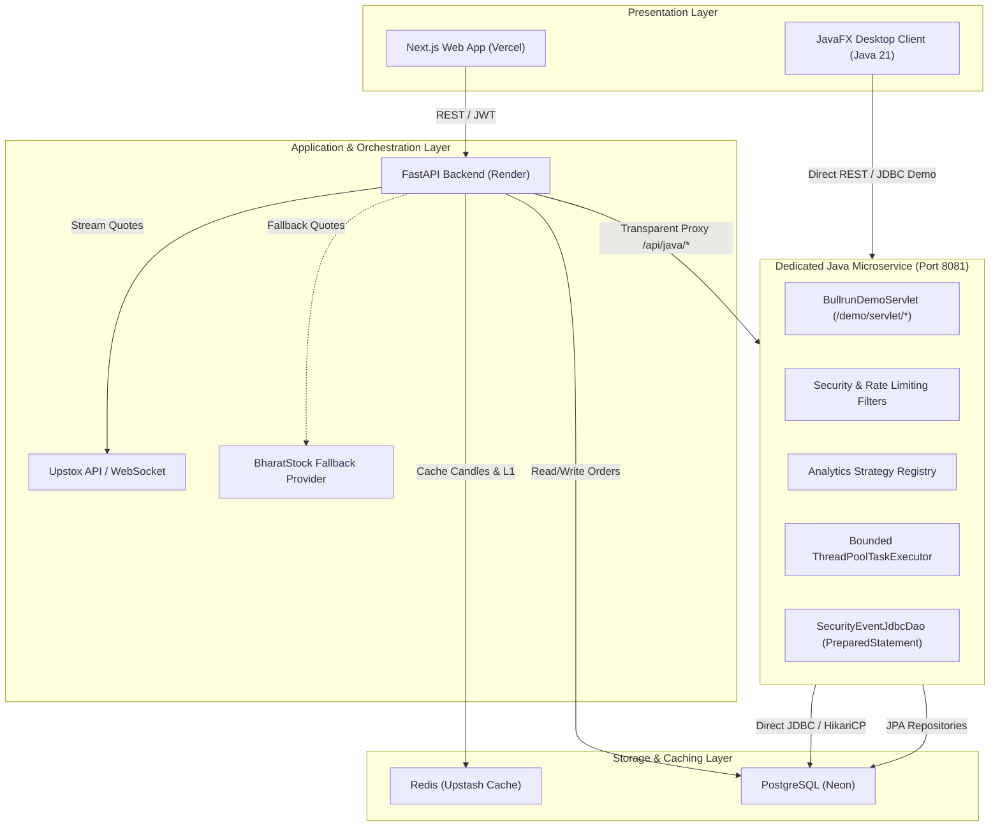
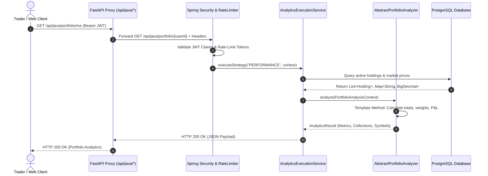
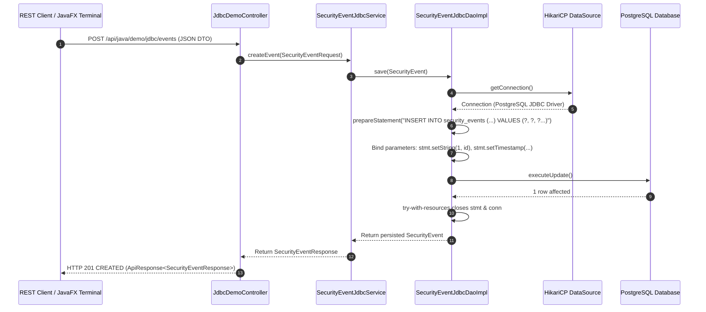

# BullRun — Java System Design & Architecture Specification

## 1. Executive Summary & Problem Understanding

### 1.1 Problem Statement
Modern retail paper-trading platforms frequently grapple with three core challenges:
1. **Financial Precision & State Integrity**: Floating-point rounding errors can corrupt P&L and risk assessments across high-frequency paper simulations.
2. **High-Throughput Analytics & Concurrency Bottlenecks**: Computing multi-asset risk metrics (Value-at-Risk, Herfindahl-Hirschman concentration, sector exposure) synchronously degrades web response latency and creates thread contention.
3. **Security Auditing & Audit Trail Reliability**: Regulatory compliance necessitates tamper-evident, low-latency audit event persistence without introducing ORM overhead or credential exposure.

### 1.2 Target Users
- **Active Paper Traders**: Require real-time portfolio analytics, unrealized/realized P&L calculations, and sector diversification feedback.
- **Risk Analysts & Platform Admins**: Require live visibility into system risk metrics, suspicious activity logging, rate-limit violations, and high-severity security events.
- **Academic Evaluators**: Require clean demonstration of Java Enterprise patterns (OOP, Collections, Generics, Multithreading, direct JDBC, and Jakarta Servlets).

---

## 2. System Architecture & Component Responsibilities

The BullRun ecosystem employs a polyglot microservice architecture designed for separation of concerns and high fault tolerance:

```
+---------------------------------------------------------------------------------------+
|                                    BullRun Platform                                    |
|                                                                                       |
|   +-----------------------+                    +----------------------------------+   |
|   |   Web Client          |                    |   JavaFX Desktop Client          |   |
|   |   (Next.js / React)   |                    |   (java-gui-client)              |   |
|   +-----------+-----------+                    +-----------------+----------------+   |
|               |                                                  |                    |
|               | HTTPS / WSS                                      | Direct HTTP (8081) |
|               v                                                  |                    |
|   +-----------------------+                                      |                    |
|   |   Python Backend      |  /api/java/* Proxy                   |                    |
|   |   (FastAPI / Render)  |---------------------+                |                    |
|   +-----------+-----------+                     |                |                    |
|               |                                 v                v                    |
|               |                  +------------------------------------------------+   |
|               |                  |       Java Security & Analytics Microservice   |   |
|               |                  |       (Spring Boot 3.3.4 / Java 21)            |   |
|               |                  |  - OOP Analytics Strategy Engine               |   |
|               |                  |  - Multithreaded CompletableFuture Executor    |   |
|               |                  |  - Direct JDBC PreparedStatement DAO           |   |
|               |                  |  - Dedicated Jakarta HttpServlet (/demo/*)     |   |
|               |                  +-----------------------+------------------------+   |
|               |                                          |                            |
|               | PostgreSQL (Neon)                        | Direct JDBC / HikariCP     |
|               v                                          v                            |
|   +-------------------------------------------------------------------------------+   |
|   |                       PostgreSQL Relational Database                          |   |
|   |  - users, profiles, wallets, orders, holdings, market_prices, security_events |   |
|   +-------------------------------------------------------------------------------+   |
+---------------------------------------------------------------------------------------+
```

### Component Responsibilities:
- **Next.js Web Frontend**: High-performance SSR/CSR user interface for paper order placement and watchlist tracking.
- **FastAPI Core Backend**: Manages user authentication, Upstox WebSocket market ingestion with fallback provider, order matching engine, and transparent proxying of Java analytics routes.
- **Java Microservice (`java-security-service`)**: Dedicated Java 21 service providing:
  - Cryptographic JWT validation and rate limiting filters.
  - Polymorphic analytics strategy calculation engine (Inheritance, Polymorphism, Interfaces).
  - Bounded multi-threaded CompletableFuture calculation pipeline.
  - Direct PostgreSQL JDBC persistence via `PreparedStatement` and `try-with-resources`.
  - Jakarta `HttpServlet` mapped directly to embedded Tomcat.
- **JavaFX Desktop GUI Client (`java-gui-client`)**: Dedicated native desktop terminal featuring BullRun styling, real-time analytics dashboards, risk inspection, and JDBC audit event stream controls.

---

## 3. Architectural Diagrams (Mermaid)

### Diagram 1: Overall BullRun Architecture


### Diagram 2: Request Flow: Frontend to FastAPI to Java Microservice


### Diagram 3: Java Analytics Processing Flow (OOP, Concurrency & Streams)

```mermaid
graph LR
    subgraph Input["Input Data"]
        CTX["PortfolioAnalysisContext"]
        HOLDINGS["List<Holding>"]
        PRICES["Map<String, BigDecimal>"]
    end

    subgraph StrategyPattern["Runtime Polymorphism"]
        REGISTRY["Strategy Registry"]
        RISK_STRAT["RiskAnalyticsStrategy"]
        PERF_STRAT["PerformanceAnalyticsStrategy"]
        DIV_STRAT["DiversificationAnalyticsStrategy"]
    end

    subgraph TemplateMethod["AbstractPortfolioAnalyzer"]
        BASE["AbstractPortfolioAnalyzer"]
        RISK_IMPL["PortfolioRiskAnalyzer"]
        PERF_IMPL["PortfolioPerformanceAnalyzer"]
    end

    subgraph ConcurrentExecution["Bounded Multithreading"]
        EXECUTOR["ThreadPoolTaskExecutor (Core: 4, Max: 16)"]
        CF1["CompletableFuture: Valuation"]
        CF2["CompletableFuture: VaR Risk"]
        CF3["CompletableFuture: Alpha Benchmark"]
        CF4["CompletableFuture: Sector Allocation"]
        JOIN["CompletableFuture.allOf().join()"]
    end

    subgraph Output["Standardized Output"]
        RESULT["AnalyticsResult (Map, Set, BigDecimal)"]
        TRACKER["ConcurrentAnalyticsTracker (AtomicLong)"]
    end

    CTX --> REGISTRY
    REGISTRY -->|Polymorphic Dispatch| RISK_STRAT
    REGISTRY -->|Polymorphic Dispatch| PERF_STRAT
    REGISTRY -->|Polymorphic Dispatch| DIV_STRAT

    RISK_STRAT --> RISK_IMPL
    PERF_STRAT --> PERF_IMPL
    RISK_IMPL -.->|Inherits| BASE
    PERF_IMPL -.->|Inherits| BASE

    BASE --> EXECUTOR
    EXECUTOR --> CF1
    EXECUTOR --> CF2
    EXECUTOR --> CF3
    EXECUTOR --> CF4
    CF1 --> JOIN
    CF2 --> JOIN
    CF3 --> JOIN
    CF4 --> JOIN
    JOIN --> RESULT
    RESULT --> TRACKER
```


### Diagram 4: Database & Direct JDBC Access Flow


---

## 4. Database Schema & Entities

The Java persistence layer maps cleanly onto the existing PostgreSQL schema without destructive migrations:

| Entity Class | Table Name | Key Attributes | Java Persistence Mechanism |
| :--- | :--- | :--- | :--- |
| `SecurityEvent` | `security_events` | `id`, `user_id`, `event_type`, `endpoint`, `http_method`, `status`, `timestamp`, `severity`, `reason`, `ip_address`, `metadata` | **Direct JDBC PreparedStatement** (`SecurityEventJdbcDaoImpl`) & Spring Data JPA (`SecurityEventRepository`) |
| `Holding` | `holdings` | `id`, `user_id`, `stock_id`, `quantity`, `average_buy_price` | Spring Data JPA (`HoldingRepository`) |
| `Stock` | `stocks` | `id`, `symbol`, `name`, `sector`, `lot_size` | Spring Data JPA (`StockRepository`) |
| `MarketPrice` | `market_prices` | `id`, `stock_id`, `ltp`, `price_change`, `updated_at` | Spring Data JPA (`MarketPriceRepository`) |
| `Wallet` | `wallets` | `id`, `user_id`, `balance`, `currency` | Spring Data JPA (`WalletRepository`) |
| `Order` | `orders` | `id`, `user_id`, `stock_id`, `order_type`, `status` | Spring Data JPA (`OrderRepository`) |

---

## 5. Security Boundaries and Role-Based Access Control (RBAC)

1. **Stateless JWT Validation**: Every request to `/api/java/portfolio/**` or `/api/java/security/**` passes through `JwtAuthenticationFilter`, which verifies HMAC-SHA256 signature and parses subject `userId` and `roles`.
2. **Access Control**:
   - `TRADER` / `USER`: Permitted to access `/api/java/portfolio/me` and `/api/java/portfolio/{ownUserId}`. Cross-user access is blocked with HTTP 403 `AccessDeniedException`.
   - `ADMIN`: Permitted to inspect security events (`/api/java/security/events`), alerts, and summary metrics.
   - `PUBLIC`: Permitted for `/api/java/health`, `/actuator/**`, `/demo/servlet/**`, and `/api/java/demo/**` for rubric demonstrations.
3. **Rate Limiting**: `RateLimitingFilter` enforces client IP and user bucket rate limits (60-120 req/min) to prevent brute-force attacks.
4. **Secret Protection**: Passwords, database connection credentials, and JWT keys are sourced exclusively from environment variables and never logged or exposed in stack traces.

---

## 6. Error Handling & Deployment Architecture

### Centralized Exception Architecture (`GlobalExceptionHandler`)
- `InvalidAnalyticsRequestException` -> **HTTP 400 Bad Request**
- `PortfolioDataNotFoundException` -> **HTTP 404 Not Found**
- `DatabaseOperationException` -> **HTTP 500 Internal Server Error** (Sanitized without exposing SQL error strings)
- `MethodArgumentNotValidException` -> **HTTP 400 Bad Request** (Field error breakdown)
- `AccessDeniedException` -> **HTTP 403 Forbidden**
- `InvalidTokenException` -> **HTTP 401 Unauthorized**

### Deployment Topology
- **Frontend**: Next.js deployed on Vercel with automatic edge SSL.
- **Python Backend**: FastAPI deployed on Render Web Service.
- **Java Service**: Spring Boot standalone runnable JAR containerized on port 8081.
- **Desktop Client**: JavaFX standalone desktop client executable via Maven or shade JAR.
- **Database**: PostgreSQL hosted on Neon with connection pooling.
